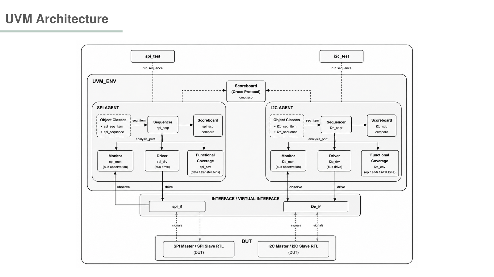
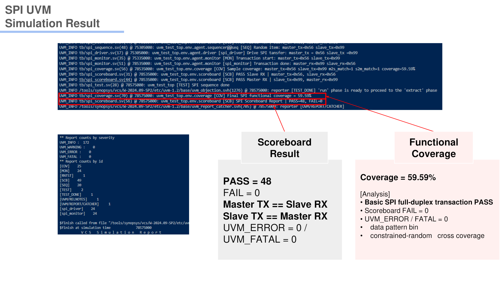
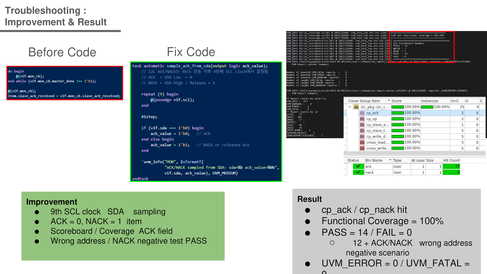
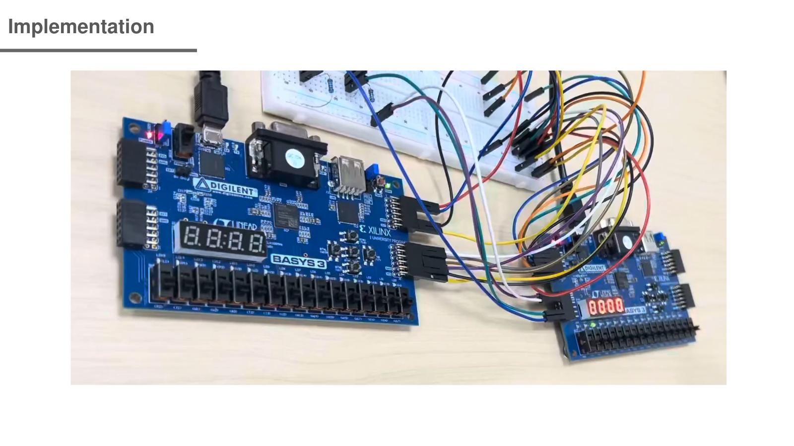

# SPI / I2C RTL & UVM Verification

SPI와 I2C Master/Slave RTL을 설계하고, SystemVerilog/UVM 환경에서 protocol transaction과 corner case를 검증한 3인 팀 프로젝트입니다. 이 저장소는 팀 전체 코드를 공개하되 아래에 제 개인 구현 범위를 명확히 구분합니다.



## Project Scope

- **Type:** 3-person Team Project
- **Language:** SystemVerilog
- **Methodology:** UVM
- **Design:** SPI Master/Slave, I2C Master/Slave
- **Validation:** Simulation and board-to-board communication

## Team and My Role

팀은 총 3명으로 진행했으며 역할은 다음과 같습니다.

- **My role:** SPI Master/Slave RTL 설계
- **Team member:** I2C Master/Slave 설계
- **Team member:** backbone 작업 및 SPI/I2C 연결

저장소에는 UVM testbench와 보드 검증 자료를 포함한 팀 프로젝트 전체 결과물이 들어 있습니다. 개인 기여로 확실히 확인된 SPI RTL만 제 역할로 표시하며, 나머지는 팀 전체 결과로 구분합니다.

## SPI Design and Verification

SPI Master가 `SCLK`, `CS_n`, `MOSI`를 구동하고 Slave가 `MISO`로 응답하는 full-duplex 구조입니다. Directed data와 random transaction을 sequence로 생성하고 monitor/scoreboard에서 Master·Slave 수신 데이터를 비교했습니다.

- Scoreboard: **48 Pass / 0 Fail**
- Functional Coverage: **59.59%**

59.59%는 프로젝트에서 정의한 coverpoint 기준의 실제 결과이며, 미도달 bin을 포함한 상태 그대로 기록했습니다.



## I2C Design and Verification

Open-drain `SDA`와 `SCL`을 이용하는 Master/Slave 구조를 구현하고 START, address, R/W, ACK/NACK, data, STOP 순서를 검증했습니다.

팀 검증의 초기 결과는 transaction 비교 **12 Pass / 0 Fail**, 전체 coverage **85.71%**였지만 ACK/NACK 관련 coverage가 0%였습니다. Driver가 ACK를 9번째 SCL 구간이 아닌 잘못된 시점에 sampling하던 문제가 확인되었습니다.

ACK sampling 시점을 9번째 SCL high 구간으로 수정한 뒤:

- Scoreboard: **14 Pass / 0 Fail**
- Functional Coverage: **100%**



## FPGA Validation

RTL simulation 이후 FPGA 보드 사이에 SPI/I2C 신호를 연결해 통신 동작을 확인했습니다.



## Repository Structure

```text
spi/rtl/       SPI Master/Slave RTL
spi/tb/        SPI UVM environment
i2c/rtl/       I2C Master/Slave RTL
i2c/tb/        I2C UVM environment
fpga/          Master/Slave top, shared RTL, Basys3 XDC
docs/assets/   Architecture and result images
docs/original/ Original reports, logs, PPTX, schedule
```

UVM testbench 실행에는 UVM을 지원하는 simulator가 필요합니다. 프로젝트 원본 보고서와 발표자료는 [`docs/original`](docs/original)에 있습니다.
